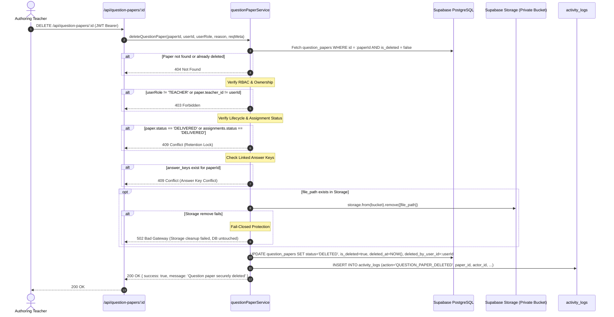

# ExamGuard — Secure Question Paper Deletion

**Module 20 Documentation | Secure Examination Question Paper Management System**

---

## 1. Overview & Threat Model

In academic examination security, question paper deletion cannot be treated as a casual database row deletion (`DELETE FROM question_papers`). Deletion of examination material involves sensitive cryptographic artifacts, physical storage references, compliance auditing, and strict examination lifecycle constraints.

ExamGuard implements a **multi-layer, fail-closed, authenticated soft-deletion and storage-erasure pipeline** for question papers.

### Threat Model & Defense Mechanisms

| Threat / Vulnerability | Risk | ExamGuard Defense Mechanism |
|:---|:---|:---|
| **Insecure Direct Object Reference (IDOR)** | Malicious teacher sends `DELETE /api/question-papers/:id` targeting another faculty member's paper. | Strict server-side ownership enforcement: `paper.teacher_id === req.user.id`. Frontend IDs or owner parameters are never trusted. |
| **Post-Distribution Deletion** | Teacher attempts to delete a paper that has already been delivered, printed, or scheduled for an active examination session. | Lifecycle barrier: Papers with status `DELIVERED` or with delivered assignments cannot be deleted under university examination retention policies. |
| **Orphaned Ciphertext in Private Storage** | Database row is marked deleted or removed, but ciphertext remains stored in Supabase private bucket. | Storage-First Atomic Deletion: Encrypted ciphertext is removed from private Supabase Storage *before* database records are archived. |
| **Storage Deletion Failure (Orphaned State)** | Storage deletion fails or network times out, leaving inconsistent state. | **Fail-Closed Guarantee**: If Supabase Storage `remove()` returns an error, the database transaction aborts immediately with `502 Bad Gateway`. The database row remains intact. |
| **Silent Audit Disappearance** | Paper disappears without an accountable paper trail. | Immutable Audit Logging: Every deletion event records an entry in `activity_logs` with actor ID, IP address, user agent, timestamp, paper metadata, and optional deletion reason. |
| **Replay / Double Deletion** | Repeated deletion requests for the same paper ID. | Idempotency & 404 Guard: Deleted papers are excluded from queries (`is_deleted = false` and `status != 'DELETED'`), returning `404 Not Found`. |

---

## 2. Database Schema & Migration

The migration is defined in [`database/module_20_question_paper_deletion_migration.sql`](file:///c:/Users/visha/OneDrive/Pictures/Desktop/ExamGaurd-main/database/module_20_question_paper_deletion_migration.sql).

### 2.1 Table Alterations

```sql
-- Add deletion lifecycle columns to question_papers
ALTER TABLE question_papers
  ADD COLUMN IF NOT EXISTS is_deleted BOOLEAN DEFAULT FALSE NOT NULL,
  ADD COLUMN IF NOT EXISTS deleted_at TIMESTAMPTZ DEFAULT NULL,
  ADD COLUMN IF NOT EXISTS deleted_by_user_id UUID REFERENCES users(id) ON DELETE SET NULL,
  ADD COLUMN IF NOT EXISTS deletion_reason TEXT DEFAULT NULL;

-- Update status check constraint to permit 'DELETED'
ALTER TABLE question_papers DROP CONSTRAINT IF EXISTS question_papers_status_check;
ALTER TABLE question_papers ADD CONSTRAINT question_papers_status_check 
  CHECK (status IN ('DRAFT', 'SUBMITTED', 'PENDING_REVIEW', 'APPROVED', 'REJECTED', 'DELIVERED', 'GENERATED', 'ARCHIVED', 'DELETED'));

-- Indexes for efficient filtering and audit queries
CREATE INDEX IF NOT EXISTS idx_question_papers_is_deleted ON question_papers(is_deleted);
CREATE INDEX IF NOT EXISTS idx_question_papers_teacher_active ON question_papers(teacher_id) WHERE is_deleted = FALSE;
CREATE INDEX IF NOT EXISTS idx_question_papers_deleted_at ON question_papers(deleted_at) WHERE is_deleted = TRUE;
```

---

## 3. Business Logic & Lifecycle Rules

### 3.1 Eligibility Matrix

| Lifecycle Status | Assignment Status | Answer Keys Linked | Deletion Allowed? | HTTP Status / Reason |
|:---|:---|:---|:---:|:---|
| `DRAFT` | None | None | **YES** | 200 OK |
| `GENERATED` | None | None | **YES** | 200 OK |
| `PENDING_REVIEW` | None | None | **YES** | 200 OK |
| `REJECTED` | None | None | **YES** | 200 OK |
| `SUBMITTED` | PENDING | None | **YES** | 200 OK (Unassigned/unopened) |
| `DELIVERED` | DELIVERED | Any | **NO** | 409 Conflict (Delivered examination paper subject to retention policy) |
| Any | DELIVERED | Any | **NO** | 409 Conflict (Active assignment delivered to exam coordinator) |
| Any | Any | Valid Answer Key | **NO** | 409 Conflict (Linked answer key must be unlinked or deleted first) |
| Non-owner | Any | Any | **NO** | 403 Forbidden ("You are not authorised to delete this question paper") |
| Deleted paper | Any | Any | **NO** | 404 Not Found |

### 3.2 Storage Erasure Sequence (Fail-Closed)



---

## 4. API Specification

### Endpoint: `DELETE /api/question-papers/:id`

- **Authentication:** Required (JWT Bearer token in `Authorization` header)
- **RBAC Role:** `TEACHER` (ownership check enforced against `teacher_id`)
- **URL Parameters:**
  - `id` (UUID string, required) — The UUID of the question paper to delete.
- **Request Body (Optional):**
  ```json
  {
    "reason": "Draft replaced by revised version for Midterm 2026"
  }
  ```

### Response Status Codes

| Status | Code | Description | Example Payload |
|:---|:---|:---|:---|
| **200 OK** | `SUCCESS` | Paper securely deleted, storage cleared, and audited | `{"success": true, "message": "Question paper securely deleted"}` |
| **400 Bad Request** | `INVALID_UUID` | Provided ID is not a valid UUID | `{"error": "Invalid question paper ID format"}` |
| **401 Unauthorized** | `AUTH_REQUIRED` | Missing, expired, or invalid JWT | `{"error": "Authentication required"}` |
| **403 Forbidden** | `FORBIDDEN` | Caller is not a Teacher or does not own the paper | `{"error": "You do not have permission to delete this question paper"}` |
| **404 Not Found** | `NOT_FOUND` | Paper ID does not exist or is already deleted | `{"error": "Question paper not found"}` |
| **409 Conflict** | `LOCKED` | Paper is delivered or linked to delivered exam | `{"error": "Delivered question papers cannot be deleted due to audit retention policies"}` |
| **502 Bad Gateway** | `STORAGE_ERROR` | Supabase storage deletion failed | `{"error": "Failed to remove encrypted file from secure storage. Deletion aborted."}` |

---

## 5. Frontend UI Implementation

### 5.1 Components

1. **[`Frontend/src/components/DeletePaperModal.jsx`](file:///c:/Users/visha/OneDrive/Pictures/Desktop/ExamGaurd-main/Frontend/src/components/DeletePaperModal.jsx)**
   - Renders a modal dialog preventing accidental clicks.
   - Summarises paper metadata: Subject Name, Subject Code, Semester, Status, Created Date.
   - Provides an optional Deletion Reason text area.
   - Displays clear warning banner stating that cryptographic keys and ciphertext will be permanently purged.
   - Disables submit button and shows loading spinner during execution.

2. **[`Frontend/src/pages/TeacherHome.jsx`](file:///c:/Users/visha/OneDrive/Pictures/Desktop/ExamGaurd-main/Frontend/src/pages/TeacherHome.jsx)**
   - Displays a red trash icon / "Delete" button only for eligible papers (papers owned by current teacher that are not in `DELIVERED` state).
   - Re-fetches the question paper list and dashboard counters immediately upon successful deletion.
   - Surfaces toast notifications for success and detailed error messages.

---

## 6. Verification & Regression Coverage

The complete deletion test suite is implemented in [`Backend/scripts/verifyQuestionPaperDeletion.js`](file:///c:/Users/visha/OneDrive/Pictures/Desktop/ExamGaurd-main/Backend/scripts/verifyQuestionPaperDeletion.js), asserting **44 rigorous test cases**:

1. Valid deletion of DRAFT papers with storage file cleanup.
2. Valid deletion of SUBMITTED papers without delivered assignments.
3. IDOR rejection when Teacher B attempts to delete Teacher A's paper (HTTP 403).
4. Non-teacher role rejection (e.g. Exam Coordinator or Student, HTTP 403).
5. Deletion blocking for DELIVERED papers (HTTP 409).
6. Deletion blocking when assignment is DELIVERED (HTTP 409).
7. Deletion blocking when active answer key is linked (HTTP 409).
8. Fail-closed behavior on storage error (HTTP 502, database record remains unchanged).
9. Idempotent re-deletion returning HTTP 404.
10. Malformed UUID validation (HTTP 400).
11. Unauthenticated request rejection (HTTP 401).
12. Audit log entry generation with matching actor ID, action `QUESTION_PAPER_DELETED`, and metadata.
