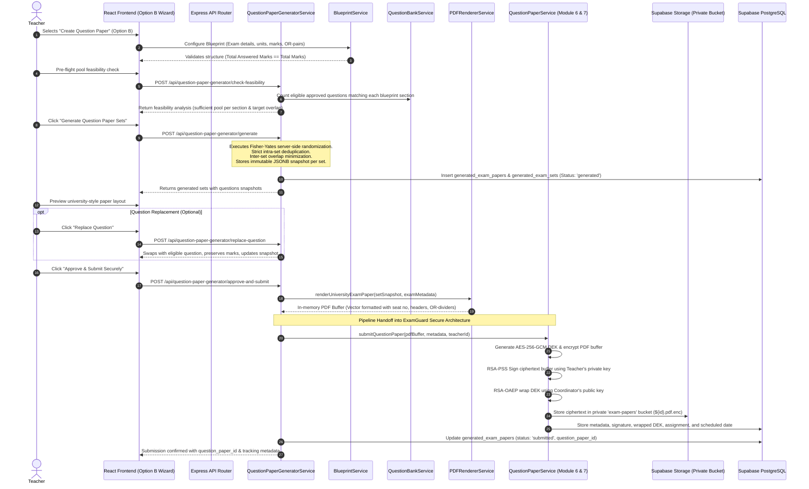

# ExamGuard — Module 18: Question Paper Generation Flow

## End-to-End Workflow

---

## Randomized Selection Algorithm Details

1. **Pre-flight Feasibility Check**:
   - For each blueprint section $S_i$, queries active questions where:
     - `subject == blueprint.subject`
     - `unit_number == S_i.unit_number`
     - `marks == S_i.required_marks`
     - `approval_status == 'approved'`
   - Computes minimum pool required across all sets:
     $$\text{RequiredPool}(S_i) = \text{UniqueNeeded}(S_i) = \lceil \text{sets\_count} \times (1 - \text{max\_overlap}) \rceil$$
   - If pool is insufficient, detailed diagnostics report which unit, question number, and mark value lacks questions.

2. **Server-Side Randomization**:
   - Cryptographically secure pseudo-random numbers (or Fisher-Yates array shuffling) select questions from the pool.
   - For Set 0: Picks randomly from available pool matching section criteria.
   - For Set $k > 0$:
     - Attempts to pick questions not used in sets $0 \dots k-1$.
     - If non-overlapping pool is depleted, gracefully samples with minimal overlap while keeping $\text{Overlap} \le \text{max\_overlap\_percentage}$.
     - Emits audit warnings if requested overlap constraints cannot be strictly maintained due to question-bank pool size.

3. **Intra-Set Uniqueness Guarantee**:
   - Under no circumstances does a single generated set contain the same `question_id` more than once, even across different sections or OR-groups.

---

## Security Pipeline Integration

Generated papers do not take shortcuts or bypass the production security pipeline:
1. **No Disk Exposure**: The rendered university PDF buffer exists strictly in backend memory (`Buffer.from(...)`). It is never written to unencrypted temporary disk files.
2. **AES-256-GCM Envelope Encryption**:
   - Random 256-bit Data Encryption Key (DEK).
   - 12-byte random Initialization Vector (IV).
   - 16-byte Authentication Tag ensuring ciphertext integrity and authenticity.
3. **RSA-PSS Digital Signature**:
   - SHA-256 hash calculated across the ciphertext buffer.
   - Signed using RSA-PSS with 2048-bit teacher signing key and salt length 32.
4. **RSA-OAEP Key Wrapping**:
   - DEK encrypted with Coordinator's RSA-2048 public key using OAEP padding (SHA-256).
5. **Private Supabase Storage**:
   - Ciphertext stored as `${paperId}.pdf.enc`.
   - Access denied to public and unauthenticated requests.
6. **Scheduled Delivery Enforcement**:
   - Coordinator and recipients cannot decrypt the paper until the scheduled delivery date/time passes.
