# ExamGuard — Simple Step-by-Step User Manual
**A Complete Beginner-Friendly Guide with Real Application Screenshots**

---

## Welcome to ExamGuard

Welcome to **ExamGuard**! This user manual is designed for teachers, examination officers, and administrators who are using ExamGuard for the very first time.

You do **not** need any computer science or cybersecurity background to use this system. Every instruction in this guide is written in clear, everyday language with step-by-step actions and real screenshots from the live application.

---

# Table of Contents

1. [What is ExamGuard?](#1-what-is-examguard)
2. [How to Log In](#2-how-to-log-in)
   - 2.1 Opening the Login Page
   - 2.2 Entering Your Credentials
   - 2.3 What Happens When You Log In
   - 2.4 Handling Login Errors
3. [Understanding the Three Roles](#3-understanding-the-three-roles)
4. [Teacher Guide — Complete Walkthrough](#4-teacher-guide--complete-walkthrough)
   - 4.1 What Teachers Do
   - 4.2 The Teacher Dashboard
   - 4.3 Viewing Your Own Authored Papers
   - 4.4 Viewing Papers Assigned to You
   - 4.5 How to Upload an Existing PDF Question Paper (Option A)
   - 4.6 How to Generate a Question Paper via the Wizard (Option B)
   - 4.7 How to Verify That a Paper Has Not Been Modified
   - 4.8 How to Download a Question Paper (and Scheduled Delivery Dates)
   - 4.9 How to Upload and Manage Post-Exam Answer Keys
   - 4.10 How to Delete an Authored Paper Safely
   - 4.11 What Teachers Cannot Do
5. [Exam Coordinator Guide — Complete Walkthrough](#5-exam-coordinator-guide--complete-walkthrough)
   - 5.1 What Exam Coordinators Do
   - 5.2 The Coordinator Dashboard
   - 5.3 Finding Papers with Search and Filters
   - 5.4 Viewing Paper Details
   - 5.5 Checking Paper Signatures
   - 5.6 Downloading the Paper on Exam Day
   - 5.7 Accessing Post-Exam Answer Keys
   - 5.8 What Coordinators Cannot Do
6. [Administrator Guide — Complete Walkthrough](#6-administrator-guide--complete-walkthrough)
   - 6.1 What Administrators Do
   - 6.2 The Administrator Dashboard
   - 6.3 Creating a New User Account
   - 6.4 Activating or Deactivating an Account
   - 6.5 Changing a User's Role
   - 6.6 Resetting a User's Password
   - 6.7 Viewing the Security Audit Logs
   - 6.8 Inspecting Audit Event Details
   - 6.9 Important Administrator Safety Rules
7. [Simple Flowcharts of Daily Workflows](#7-simple-flowcharts-of-daily-workflows)
   - 7.1 Login & Dashboard Access
   - 7.2 Teacher Upload Workflow
   - 7.3 Automatic Paper Generator Workflow
   - 7.4 Scheduled Delivery Date Workflow
   - 7.5 Coordinator Download Workflow
   - 7.6 Answer Key Submission Window
   - 7.7 Secure Deletion Workflow
8. [Troubleshooting & Frequently Asked Questions (FAQ)](#8-troubleshooting--frequently-asked-questions-faq)
   - 8.1 Common Questions
   - 8.2 Solutions to Common Problems
9. [Security Tips for Everyday Use](#9-security-tips-for-everyday-use)
10. [Glossary of Simple Terms](#10-glossary-of-simple-terms)

---

# 1. What is ExamGuard?

In many colleges and universities, examination question papers are emailed as attachments, shared on Google Drive, or carried on USB pen drives. These old methods are dangerous:
- Files can be forwarded or intercepted by unauthorized people.
- Papers can be leaked days before the exam takes place.
- Someone could change a number or formula inside the document, and nobody would know.
- USB drives can be lost or copied.

**ExamGuard solves this completely:**
1. **Instant Protection**: The moment a teacher uploads a question paper, the system locks it in a digital vault using military-grade encryption (AES-256).
2. **Digital Wax Seal**: The system stamps a unique digital seal on the file (an RSA-PSS digital signature). If anyone tampers with even a single dot, the seal breaks and warns you.
3. **Time-Locked Delivery**: People cannot download the paper whenever they want. The system keeps it locked until the official scheduled delivery date.
4. **Answer Key Protection**: Answer keys cannot be uploaded before an exam happens, preventing leaks.
5. **No Secrets in Plain Text**: The actual unencrypted PDF is never stored on disk. It is decrypted only in computer memory for the person authorized to view it.

---

# 2. How to Log In

### 2.1 Opening the Login Page
Open your web browser (Google Chrome, Microsoft Edge, Firefox, or Safari) and go to:
**`https://examguardapp.vercel.app/login`**

You will see the secure login screen:

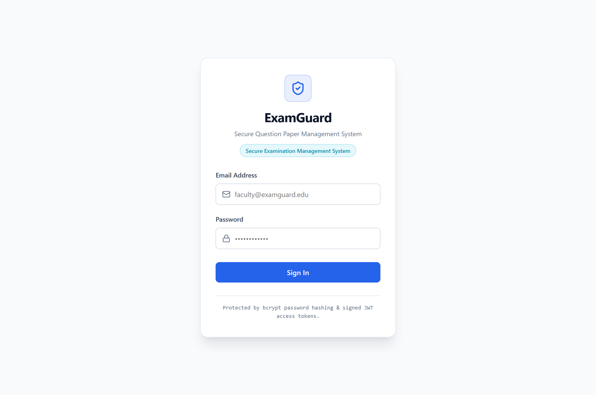

*Figure 1: ExamGuard Secure Login Screen.*

- **What you are looking at**: The clean, dark-theme login portal of ExamGuard.
- **Key elements**:
  - The **Email Address** box with the mail icon.
  - The **Password** box with the lock icon.
  - The blue **Sign In to Secure Workspace** button.
  - The bottom demo card showing sample accounts.
- **What to do**: Click inside the Email field and type your institutional email address.
- **Expected result**: Your email appears in the box.

---

### 2.2 Entering Your Credentials
Type your registered institutional email address and your password.

The official demonstration accounts available on the system are:
- **Teacher**: `teacher@examguard.edu` | Password: `Teacher@ExamGuard2026`
- **Exam Coordinator**: `coordinator@examguard.edu` | Password: `Coord@ExamGuard2026`
- **Administrator**: `admin@examguard.edu` | Password: `Admin@ExamGuard2026`

Click the blue **Sign In to Secure Workspace** button.

---

### 2.3 What Happens When You Log In
When you click **Sign In**:
1. The server checks your email and verifies your password securely.
2. If your credentials are correct, you will see a green notice: *"Authentication successful! Redirecting..."*
3. The system automatically reads your assigned role and takes you directly to your workspace:
   - Teachers go to `/teacher`.
   - Coordinators go to `/exam-coordinator`.
   - Administrators go to `/admin`.
4. Your login session stays active for **24 hours**. When you are done, click the **Sign Out** button in the top-right corner.

---

### 2.4 Handling Login Errors
If you type the wrong email or an incorrect password, ExamGuard displays a clear red alert message:

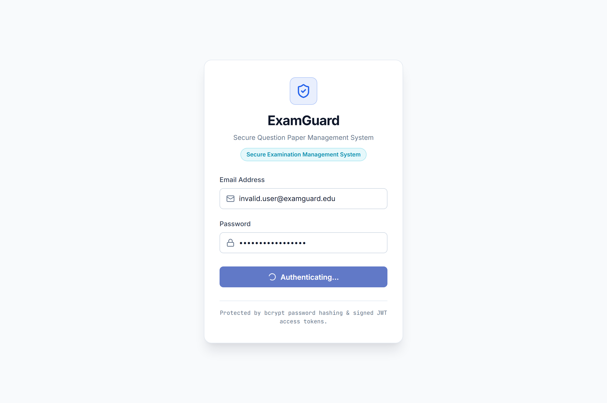

*Figure 2: Login Validation Error Screen.*

- **What you are looking at**: The red warning banner that appears when login fails.
- **Key elements**: The red alert box with the text *"Invalid email or password"*.
- **What to do**: Double-check your spelling and Caps Lock key. Re-type your email and password, then click Sign In again.
- **Expected result**: Once corrected, the red banner disappears and you are logged in.

---

# 3. Understanding the Three Roles

ExamGuard uses **Role-Based Access Control**. This means what you can see and do depends on your job:

```
+-----------------------------------------------------------------------------------+
| USER ROLES IN EXAMGUARD                                                           |
+-----------------------------------------------------------------------------------+
| TEACHER              | EXAM COORDINATOR         | ADMINISTRATOR                   |
|----------------------+--------------------------+---------------------------------|
| - Uploads papers     | - Receives papers        | - Creates user accounts         |
| - Generates papers   | - Verifies signatures    | - Activates / deactivates users |
| - Reviews assignments| - Downloads on exam day  | - Resets forgotten passwords    |
| - Uploads answer keys| - Views answer keys      | - Reviews security audit logs   |
| - Deletes own drafts | - Views exam rosters     | - CANNOT see or decrypt papers  |
+-----------------------------------------------------------------------------------+
```

---

# 4. Teacher Guide — Complete Walkthrough

### 4.1 What Teachers Do
As a faculty member or teacher, you author examination question papers. In ExamGuard, you can:
- Upload finalized PDF question papers you prepared offline.
- Use the built-in wizard to assemble a fresh question paper from an institutional question bank.
- Check the cryptographic integrity of your papers anytime.
- Assign papers to reviewers or exam coordinators.
- Submit answer keys during the post-exam submission window.
- Safely delete drafts you no longer need.

---

### 4.2 The Teacher Dashboard
Log in with:
- **Email**: `teacher@examguard.edu`
- **Password**: `Teacher@ExamGuard2026`

You will arrive at your home dashboard:

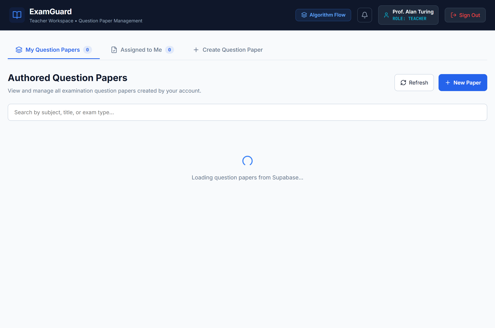

*Figure 3: Teacher Dashboard Overview.*

- **What you are looking at**: The Teacher Dashboard showing authored question papers.
- **Key elements**:
  - **Top Navigation Bar**: Displays the ExamGuard logo, your name (*Prof. Alan Turing*), your role badge (`TEACHER`), the notification bell, and the **Sign Out** button.
  - **Action Ribbon**: The **View Algorithm Flow** button (top right) and the three main workspace tabs:
    1. **My Question Papers**: Papers you authored.
    2. **Assigned to Me**: Papers authored by other teachers sent to you for review.
    3. **Create Question Paper**: Where you upload or generate new papers.
  - **Question Papers Table**: Shows Title, Subject, Semester, Exam Date, Scheduled Delivery Date, and Status badge.
  - **Action Buttons in Table**: Details (eye icon), Verify Signature (shield), Download, Answer Key, and Delete (trash).

---

### 4.3 Viewing Your Own Authored Papers
Click the **My Question Papers** tab.
- You will see a list of every paper you created.
- The status pill indicates the paper's progress:
  - `SCHEDULED`: The paper is safely encrypted and waiting for its delivery date.
  - `DELIVERED`: The delivery date has arrived; the paper is ready.
  - `SUBMITTED`: Upload completed.
- As the author, you have **instant download rights** to your own papers. You do not have to wait for the delivery date to review your work.

---

### 4.4 Viewing Papers Assigned to You
Click the **Assigned to Me** tab:

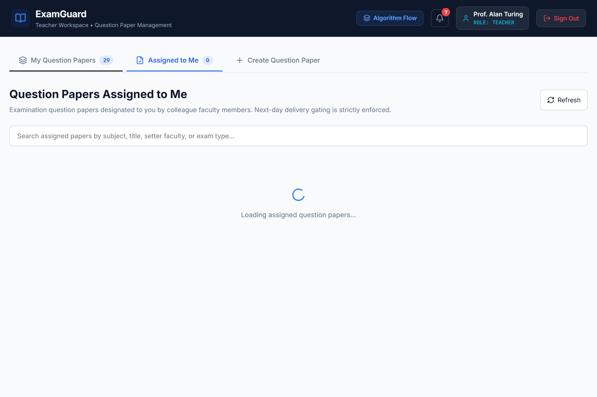

*Figure 4: Assigned to Me Papers Tab.*

- **What you are looking at**: Papers authored by colleagues that were assigned to you for co-review.
- **Key elements**:
  - The table columns showing the Author name, Scheduled Delivery Date, and Delivery Status.
  - The disabled **Download** button with a lock icon.
- **Important Rule**: For assigned papers, you cannot download the PDF until the scheduled delivery date arrives. This prevents early leakage. You can, however, verify the digital signature immediately.

---

### 4.5 How to Upload an Existing PDF Question Paper (Option A)
If you already typed and saved your question paper as a PDF on your computer, follow these steps:

1. Click the **Create Question Paper** tab.
2. Click the **Upload Existing PDF** card.
3. The upload form opens:


*Figure 5: Teacher Question Paper Upload Form (Option A).*

- **What you are looking at**: The manual PDF submission form.
- **Step-by-Step Form Inputs**:
  1. **Question Paper Title**: Enter the formal name (e.g., `Data Structures & Algorithms Final Exam`).
  2. **Subject**: Enter the course code or name (e.g., `CS-301 Computer Networks`).
  3. **Semester**: Select your semester from the dropdown (e.g., `Semester 5`).
  4. **Academic Year**: Type the session (e.g., `2026-2027`).
  5. **Exam Type**: Choose `End Semester Examination`, `In-Semester Test`, or `Class Test`.
  6. **Exam Date**: Click the calendar picker and select the future date of the exam.
  7. **Assigned Recipient**: Pick the reviewer or exam coordinator from the dropdown.
  8. **File Upload**: Drag and drop your `.pdf` file into the blue dashed box, or click to browse.
4. Click the blue **Submit Question Paper** button.
5. **What happens next**:
   - The server validates your PDF file.
   - It generates a unique 256-bit AES encryption key.
   - It encrypts the PDF so nobody can read it in storage.
   - It seals it with a digital signature.
   - It sets the delivery date to tomorrow (`today + 1 day`).
   - A green confirmation alert appears, and your paper is listed under **My Question Papers**.

---

### 4.6 How to Generate a Question Paper via the Wizard (Option B)
ExamGuard can also automatically build a complete, balanced examination paper set for you based on a university syllabus blueprint.

1. Click **Create Question Paper** $\rightarrow$ Click **Generate via Wizard**.
2. **Step 1: Exam Details & Blueprint**:

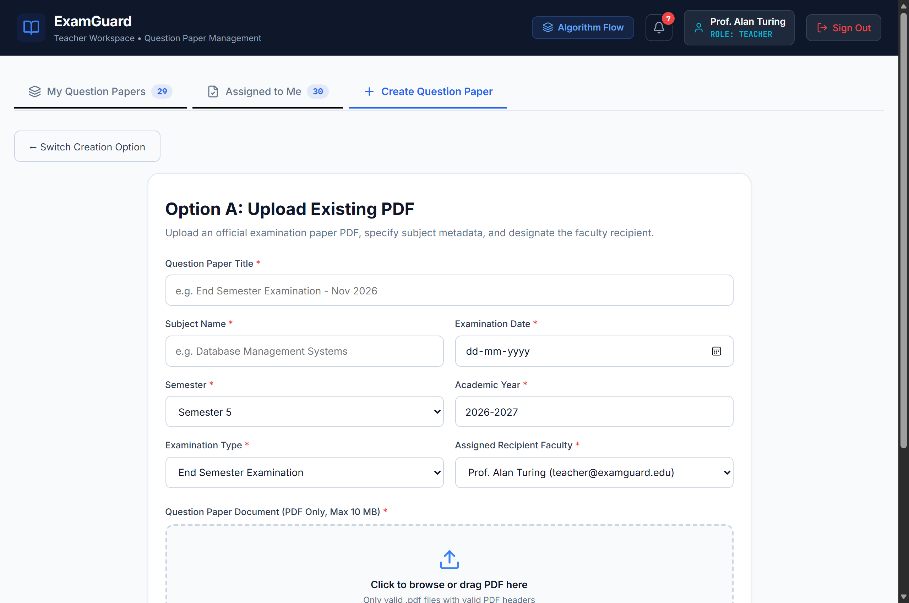

*Figure 6: Question Paper Generator Wizard — Step 1: Blueprint.*

- **What you are looking at**: Step 1 of the 5-step wizard.
- **What to do**: Review the Course, Semester, Pattern, Subject Code (`310243`), Total Marks (`70`), and Duration (`2.5 Hours`). Check the instructions.
- Click **Next: Question Bank & Units**.

3. **Step 2: Question Bank & Units**:


*Figure 7: Question Paper Generator Wizard — Step 2: Question Bank.*

- **What you are looking at**: The list of approved questions in the question bank, organized by unit number, difficulty, and marks.
- **What to do**: Review available questions. You can click **Add Question** to input your own custom question or click **Seed Default SPOS Question Bank** if the bank is empty.
- Click **Next: Feasibility & Set Generation**.

4. **Step 3: Feasibility Analysis**:


*Figure 8: Question Paper Generator Wizard — Step 3: Feasibility.*

- **What you are looking at**: The feasibility check.
- **What to do**: The system calculates whether there are enough questions to create **Set A** and **Set B** without exceeding the 40% overlap limit.
- Click **Generate Sets Now**.

5. **Step 4: Preview & In-Place Swap**:


*Figure 9: Question Paper Generator Wizard — Step 4: Preview & Swap.*

- **What you are looking at**: The generated university-style paper layout.
- **What to do**:
  - Toggle between **Set A** and **Set B**.
  - Notice the formal university header, Seat Number box, and `[OR]` question groups.
  - If you dislike a question, click **Swap Question**. A list of alternative questions with the exact same marks and difficulty opens. Pick an alternative, and the marks total updates automatically!
- Click **Next: Final Review & Submit**.
6. **Step 5: Approve & Submit**:
   - Select your recipient and exam date.
   - Check the confirmation box: *"I hereby review, approve, and authorize the generated paper."*
   - Click **Approve & Submit to Secure Pipeline**. The system renders the paper into a publication-grade PDF and encrypts it immediately.

---

### 4.7 How to Verify That a Paper Has Not Been Modified
You can verify the digital signature of any paper at any time without decrypting it:

1. Click the **View Algorithm Flow** button on the dashboard to see how the security works:

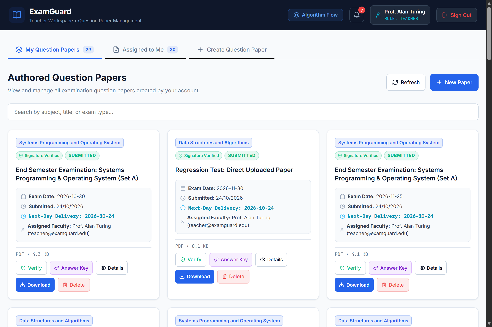

*Figure 10: Cryptographic Algorithm Flow Modal.*

- **What you are looking at**: The 11-step visual diagram explaining the cryptographic pipeline.
2. In the paper table, click the blue **Verify Signature** (shield) button next to any paper.
3. **What happens**: The system checks the digital signature against the stored file. If the file is untouched, a green confirmation badge appears: `Verified (RSA-PSS-SHA256)`. If anyone had tampered with the file, a prominent red warning would appear.

---

### 4.8 How to Download a Question Paper (and Scheduled Delivery Dates)
- In the table, click the green **Download** button.
- **For Authoring Teachers**: The paper downloads immediately as a decrypted PDF.
- **For Reviewers & Coordinators**:
  - If today's date is **before** the scheduled delivery date, the button is disabled and shows a padlock. You will see a tooltip: *"Scheduled for delivery on [Date] and cannot be downloaded yet."*
  - On or after the delivery date, the button turns green and you can download the decrypted PDF.

---

### 4.9 How to Upload and Manage Post-Exam Answer Keys
To make sure answer keys are never leaked before students take the test, ExamGuard enforces a **strict submission window**:

1. In your **My Question Papers** list, click the **Answer Key** button next to a paper.
2. The Answer Key Management Modal opens:

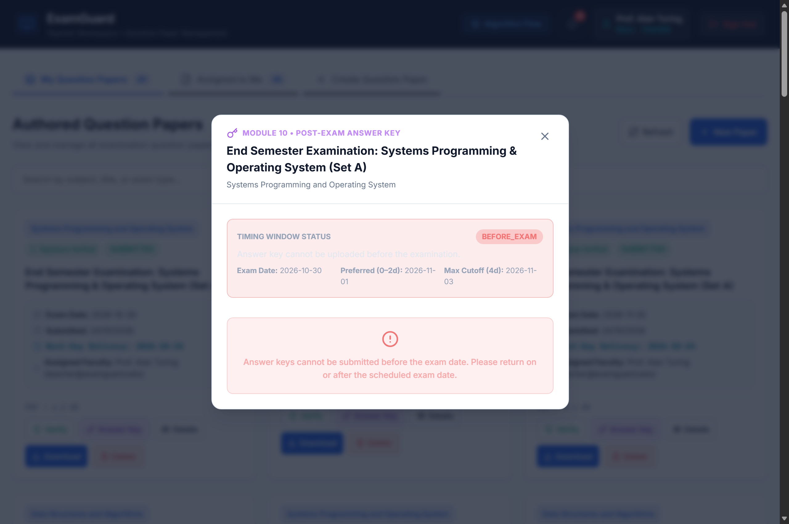

*Figure 11: Post-Exam Answer Key Modal.*

- **What you are looking at**: The Answer Key status and timing window.
- **Timing Window Rules**:
  - **Before Exam Date**: Status is `BEFORE_EXAM` in yellow. Upload is locked.
  - **Days 0–2 After Exam**: Status is `WINDOW_OPEN_PREFERRED` in green. Upload is open!
  - **Days 3–4 After Exam**: Status is `WINDOW_OPEN_EXTENDED` in amber. Upload is open!
  - **Day 5+ After Exam**: Status is `WINDOW_EXPIRED` in red. Upload is closed.
- **Uploading**: When the window is open, choose your solution PDF and click **Upload Answer Key**.
- The answer key is encrypted and signed with its own cryptographic envelope.

---

### 4.10 How to Delete an Authored Paper Safely
If you uploaded a draft paper by mistake and want to remove it:

1. In the paper table, click the red **Delete (Trash)** icon.
2. The confirmation modal opens:

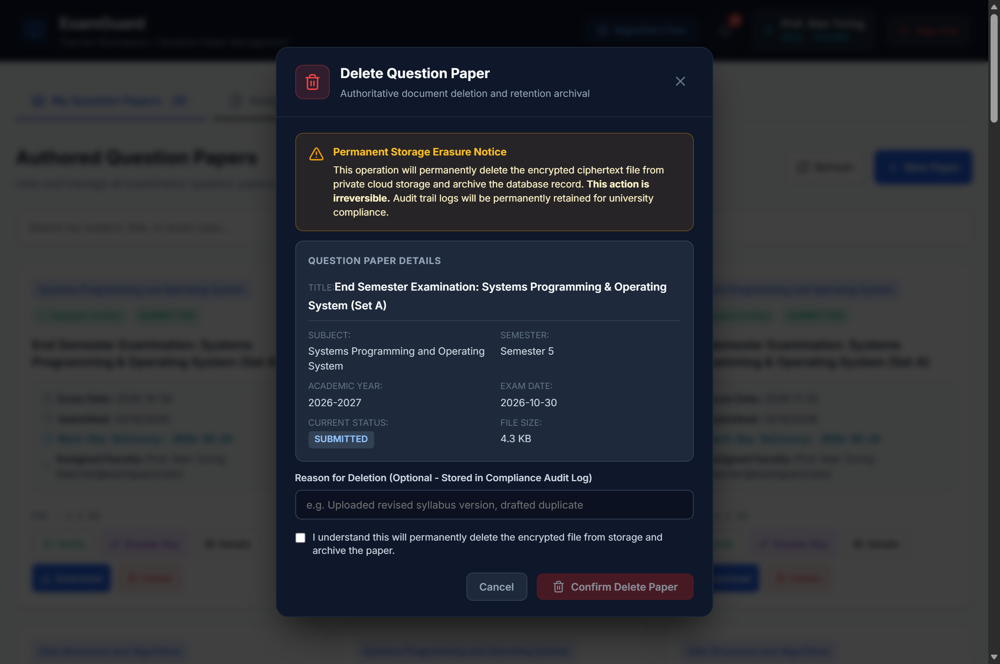

*Figure 12: Delete Question Paper Modal.*

- **What you are looking at**: The deletion safety confirmation box.
- **What to do**: Read the warning. You may optionally enter a reason in the text box.
- Click **Permanently Delete**.
- **Safety Lock**: If the paper has already reached its delivery date or was delivered to a coordinator, the system **blocks** deletion to protect institutional records. If it is still a pending draft, the file is erased from cloud storage and soft-deleted.

---

### 4.11 What Teachers Cannot Do
- Teachers cannot download assigned papers before the scheduled delivery date.
- Teachers cannot upload answer keys before the exam date.
- Teachers cannot delete papers that have already been delivered.
- Teachers cannot view or edit papers authored by other faculty unless explicitly assigned.
- Teachers cannot access administrator user management or system audit logs.

---

# 5. Exam Coordinator Guide — Complete Walkthrough

### 5.1 What Exam Coordinators Do
Exam Coordinators oversee paper distribution on examination day. In ExamGuard, coordinators:
- View all question papers assigned to their examination center.
- Verify cryptographic signatures in advance to ensure no files were corrupted or altered.
- Download decrypted examination papers once the scheduled delivery date arrives.
- Access post-exam answer keys for evaluation.

---

### 5.2 The Coordinator Dashboard
Log in with:
- **Email**: `coordinator@examguard.edu`
- **Password**: `Coord@ExamGuard2026`

You will see the Coordinator workspace:

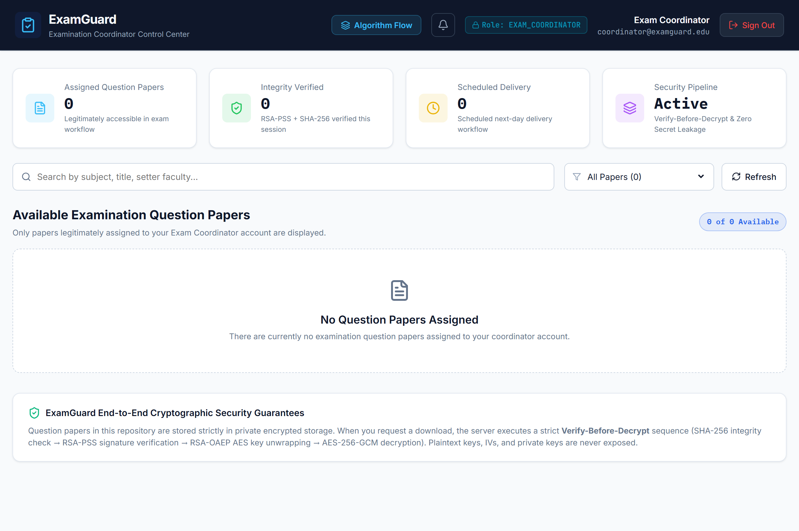

*Figure 13: Exam Coordinator Dashboard Overview.*

- **What you are looking at**: The Exam Coordinator repository.
- **Key elements**:
  - **Summary Metric Cards**: Shows Total Assigned Papers, Verified Signatures count, and Ready for Delivery count.
  - **Search & Filter Bar**: Type any subject name or choose a status (`ALL`, `SCHEDULED`, `DELIVERED`).
  - **Assigned Papers Table**: Shows Paper Title, Subject, Authoring Teacher, Delivery Date, and Status.
  - **Action Buttons**: Details (eye icon), Verify Signature (shield), Download, and View Answer Key.

---

### 5.3 Finding Papers with Search and Filters
- In the search bar at the top of the table, type any course name (e.g., `SPOS` or `Networks`). The table filters instantly.
- Click the Status dropdown to view only papers that are `SCHEDULED` or `DELIVERED`.

---

### 5.4 Viewing Paper Details
Click the **Details (Eye)** icon next to any paper:


*Figure 14: Coordinator Paper Details Modal.*

- **What you are looking at**: The complete metadata inspection sheet.
- **Information shown**: System UUID, Paper Title, Subject, Semester, Author Name, Exam Date, Scheduled Delivery Date, and File Size.
- Click **Close** to return to the table.

---

### 5.5 Checking Paper Signatures
1. In the table, click the blue **Verify Signature** button.
2. The server checks the cryptographic digest against the digital signature stored in the database.
3. A green confirmation badge confirms that the file is authentic and has not been tampered with.

---

### 5.6 Downloading the Paper on Exam Day
- When the scheduled delivery date arrives (e.g., the morning of the exam), the **Download** button turns bright green.
- Click **Download**.
- The server performs the 5-step verification pipeline:
  1. Verifies the SHA-256 hash.
  2. Verifies the RSA-PSS signature.
  3. Unwraps the AES key.
  4. Decrypts the paper.
  5. Clears the key from server memory.
- The authenticated PDF opens in your browser, ready for authorized printing in the secure exam cell.

---

### 5.7 Accessing Post-Exam Answer Keys
- Once an authoring teacher uploads the answer key after the exam, an **Answer Key** button appears in the coordinator table.
- Click **View Answer Key** to inspect verification details or download the solution guide.

---

### 5.8 What Coordinators Cannot Do
- Coordinators cannot download papers before the scheduled delivery date.
- Coordinators cannot view or download papers that were not explicitly assigned to them.
- Coordinators cannot upload or delete question papers.
- Coordinators cannot access the admin user management panel.

---

# 6. Administrator Guide — Complete Walkthrough

### 6.1 What Administrators Do
System Administrators manage institutional accounts and monitor security compliance. Administrators:
- Provision user accounts for teachers and coordinators.
- Activate or deactivate accounts when faculty join or leave.
- Assign system roles (`TEACHER`, `EXAM_COORDINATOR`, `ADMIN`).
- Assist with password resets when users forget their credentials.
- Inspect the immutable security audit trail.
- **Important Security Principle**: Administrators have **no access** to examination papers or encryption keys. They manage people and security, not confidential exam content.

---

### 6.2 The Administrator Dashboard
Log in with:
- **Email**: `admin@examguard.edu`
- **Password**: `Admin@ExamGuard2026`

You will see the Administrator portal:

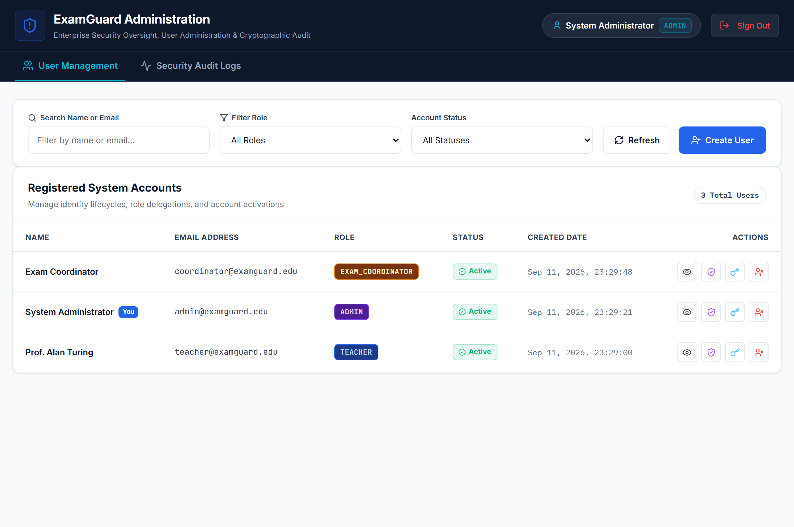

*Figure 15: Administrator User Management Dashboard.*

- **What you are looking at**: The User Management tab in `/admin`.
- **Key elements**:
  - **Top Tabs**: Switch between **User Management** and **Audit Logs**.
  - **Search & Filters**: Search users by name or email; filter by Role or Status (`ACTIVE` / `INACTIVE`).
  - **Create New User Button**: Blue button in the upper right.
  - **User Directory Table**: Displays Name, Email, Role badge, Status pill, and Action controls.
  - **Action Controls in Table**:
    - **Role Selector**: Change a user's role.
    - **Deactivate / Activate Button**: Toggle access on or off.
    - **Reset Password (Key Icon)**: Reset a user's password.

---

### 6.3 Creating a New User Account
1. Click the blue **Create New User** button.
2. The user creation form opens:

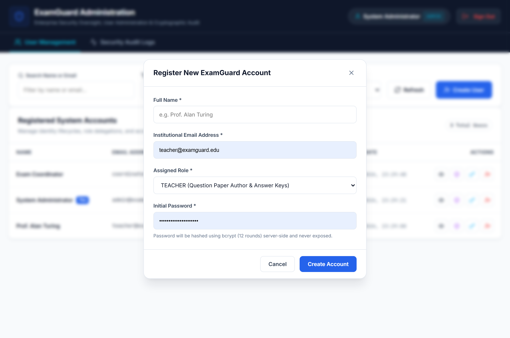

*Figure 16: Admin Create User Modal.*

- **What you are looking at**: The account provisioning dialogue.
- **Form Fields**:
  - **Full Name**: Enter the user's name (e.g., `Dr. Jane Doe`).
  - **Email Address**: Enter their institutional email (e.g., `jane.doe@examguard.edu`).
  - **Initial Password**: Enter a temporary password (must be at least 8 characters with at least 1 letter and 1 number).
  - **Role**: Select `TEACHER` or `EXAM_COORDINATOR`.
3. Click **Create User**.
4. The server hashes the password with bcrypt (12 rounds) and creates the account.

---

### 6.4 Activating or Deactivating an Account
- To disable a user (for example, if an instructor is on sabbatical or leaves the institution), click **Deactivate** next to their name.
- The status pill changes to red `INACTIVE`.
- **Immediate Effect**: The user is immediately blocked from logging in. If they have an active session, their very next click will return an access denied error.
- To re-enable the user, click **Activate**.

---

### 6.5 Changing a User's Role
- In the user table, find the **Role** column dropdown.
- Select the new role (e.g., change from `TEACHER` to `EXAM_COORDINATOR`).
- Confirm the change in the prompt. The user's permissions update instantly.

---

### 6.6 Resetting a User's Password
If a faculty member forgets their password:
1. Click the **Key Icon (Reset Password)** next to their name.
2. Type a temporary password matching complexity rules (at least 8 characters, letters and numbers).
3. Click **Save Password**. The system hashes it and updates the account.

---

### 6.7 Viewing the Security Audit Logs
Click the **Audit Logs** tab at the top of the dashboard:

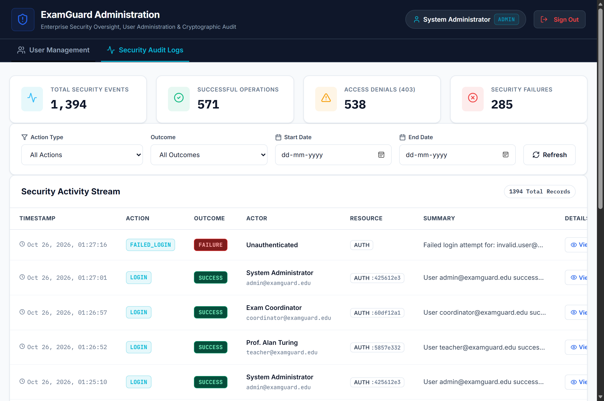

*Figure 17: Administrator Audit Logs Dashboard.*

- **What you are looking at**: The tamper-evident security audit trail.
- **Key elements**:
  - **Four Metric KPI Cards**:
    - **Total Events**: Total number of recorded actions.
    - **Success Count**: Successful logins, uploads, and downloads.
    - **Failure Count**: System or processing errors.
    - **Denied Count**: Blocked attempts, IDOR attempts, or expired window attempts.
  - **Filter Toolbar**: Filter events by Action type (e.g., `LOGIN`, `QUESTION_PAPER_SUBMITTED`, `DOWNLOAD`), Outcome (`SUCCESS`, `DENIED`), or Date Range.
  - **Audit Log Table**: Lists Event Action, Outcome pill (green/red), Actor email, Target Resource, Timestamp, and a **View Details** button.

---

### 6.8 Inspecting Audit Event Details
Click the **View Details (Eye)** icon next to any log entry:

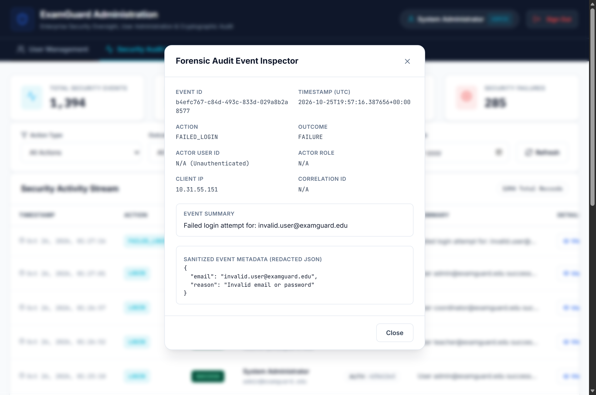

*Figure 18: Audit Log Sanitized JSON Inspection Modal.*

- **What you are looking at**: The full event inspection modal.
- **Key elements**:
  - The Event Action, Outcome, User ID, IP address, and Timestamp.
  - The formatted JSON payload box.
  - **Automatic Redaction**: Notice that sensitive information is automatically masked:
    - `"password": "[REDACTED]"`
    - `"token": "[REDACTED]"`
    - `"aesKey": "[REDACTED]"`
    - `"storagePath": "[REDACTED]"`
  - Secrets are never leaked into the audit logs.
- Click **Close** when finished.

---

### 6.9 Important Administrator Safety Rules
ExamGuard has built-in safety guardrails to protect the system:
1. **No Self-Lockout**: You cannot deactivate your own administrator account.
2. **No Self-Demotion**: You cannot change your own role away from `ADMIN`.
3. **Last Admin Protection**: You cannot deactivate or demote the last remaining active administrator account. This ensures the system can never become unmanaged.
4. **Immutable Logs**: Audit logs cannot be edited or deleted. There are no delete buttons on the audit trail.

---

# 7. Simple Flowcharts of Daily Workflows

### 7.1 Login & Dashboard Access

```
[ User enters Email & Password ]
               │
               ▼
   [ Server checks credentials ]
               │
      ┌────────┴────────┐
      │ Valid           │ Invalid
      ▼                 ▼
[ Issue 24-hr Token ]  [ Show Red Error Banner ]
      │
      ├────────────────────────┬────────────────────────┐
      ▼                        ▼                        ▼
[ Role: TEACHER ]      [ Role: COORDINATOR ]    [ Role: ADMIN ]
      │                        │                        │
      ▼                        ▼                        ▼
/teacher Dashboard     /exam-coordinator        /admin Dashboard
- My Papers            - Assigned Papers        - User Management
- Create Paper         - Signature Checks       - Audit Logs
- Answer Keys          - Download on Exam Day   - Password Resets
```

---

### 7.2 Teacher Upload Workflow

```
[ Teacher clicks "Create Question Paper" ]
                    │
                    ▼
[ Fill Title, Subject, Date & Attach PDF ]
                    │
                    ▼
[ Click "Submit Question Paper" ]
                    │
                    ▼
[ Server validates PDF magic bytes (%PDF-) ]
                    │
                    ▼
[ Encrypt PDF with unique AES-256 key ]
                    │
                    ▼
[ Wrap AES key with University Public Key ]
                    │
                    ▼
[ Seal file with RSA-PSS Digital Signature ]
                    │
                    ▼
[ Store encrypted file in private vault ]
                    │
                    ▼
[ Set Delivery Date = Tomorrow (UTC) ]
                    │
                    ▼
[ Green Confirmation Banner Shown! ]
```

---

### 7.3 Automatic Paper Generator Workflow

```
[ Step 1: Set Blueprint (Subject, Pattern, Total 70 Marks) ]
                             │
                             ▼
[ Step 2: Select Unit Questions from Question Bank ]
                             │
                             ▼
[ Step 3: Run Feasibility Check (Pool depth & Overlap <= 40%) ]
                             │
                             ▼
[ Step 4: Preview Set A & Set B (Swap any question in-place) ]
                             │
                             ▼
[ Step 5: Faculty Checkbox Approval & Submission ]
                             │
                             ▼
[ Server renders University PDF & Encrypts automatically! ]
```

---

### 7.4 Scheduled Delivery Date Workflow

```
           [ Question Paper Submitted on Day 0 ]
                             │
                             ▼
           [ Server locks Delivery Date to Day 1 ]
                             │
             ┌───────────────┴───────────────┐
             │                               │
             ▼                               ▼
    [ Before Delivery Date ]       [ On or After Delivery Date ]
             │                               │
             ▼                               ▼
- Authoring Teacher CAN download   - Authoring Teacher CAN download
- Coordinator download is LOCKED   - Coordinator download is UNLOCKED
- Lock icon shown in table         - Green Download button active
- Inline signature verification OK - Verify-Before-Decrypt streams PDF
```

---

### 7.5 Coordinator Download Workflow

```
[ Coordinator clicks "Download" on Exam Day ]
                       │
                       ▼
[ 1. Check SHA-256 fingerprint: Has file changed? ] ── Fail ──> [ STOP (Alert) ]
                       │ Pass
                       ▼
[ 2. Check Digital Signature: Is seal authentic? ] ─── Fail ──> [ STOP (Alert) ]
                       │ Pass
                       ▼
[ 3. Unwrap AES key using server private key ] ─────── Fail ──> [ STOP (Alert) ]
                       │ Pass
                       ▼
[ 4. Decrypt PDF bytes and verify Auth Tag ] ───────── Fail ──> [ STOP (Alert) ]
                       │ Pass
                       ▼
[ 5. Wipe temporary key from memory buffer ]
                       │
                       ▼
[ Stream clean, authenticated PDF to user's screen! ]
```

---

### 7.6 Answer Key Submission Window

```
      Exam Day               Exam Day + 2 Days          Exam Day + 4 Days
─────────┼───────────────────────────┼──────────────────────────┼─────────
 LOCKED  │  PREFERRED WINDOW (GREEN) │  EXTENDED WINDOW (AMBER) │ EXPIRED
 (Before │   Upload solution PDF     │    Upload solution PDF   │ (Closed)
  exam)  │                           │                          │
```

---

### 7.7 Secure Deletion Workflow

```
[ Teacher clicks Trash Icon on draft paper ]
                     │
                     ▼
[ Check: Has paper reached DELIVERED status? ] ── Yes ──> [ BLOCK: Cannot delete ]
                     │ No
                     ▼
[ Step 1: Delete encrypted file from cloud vault ] ── Fail ──> [ STOP (Fail-Closed) ]
                     │ Success
                     ▼
[ Step 2: Mark database record as DELETED ]
                     │
                     ▼
[ Step 3: Record QUESTION_PAPER_DELETED in Audit Log ]
```

---

# 8. Troubleshooting & Frequently Asked Questions (FAQ)

### 8.1 Common Questions

**Q: Can an Administrator see or read my examination questions?**  
**A:** No. Administrators can only see user accounts and audit logs. They do not have access to the cryptographic keys or permissions required to decrypt or view question papers.

**Q: Can an Exam Coordinator download a paper 3 days before the exam to print it?**  
**A:** No. ExamGuard enforces scheduled delivery date gating. Papers can only be downloaded on or after their server-calculated scheduled delivery date.

**Q: What if I uploaded the wrong PDF by mistake?**  
**A:** If the paper has not yet been delivered to an exam coordinator, you can click the red **Delete (Trash)** button to permanently erase the encrypted file and upload the correct one.

**Q: What happens if someone hacks into the cloud storage bucket directly?**  
**A:** They will only find scrambled ciphertext files (`.enc`). Without the unique 32-byte AES key (which is wrapped with an RSA key stored separately on the server), the stolen files cannot be opened.

---

### 8.2 Solutions to Common Problems

| Problem | Cause | How to Fix It |
| :--- | :--- | :--- |
| **"Invalid email or password"** | Typo in email or password. | Check Caps Lock; re-type carefully; or ask an Admin to reset your password. |
| **"Account has been deactivated"** | Admin disabled the account. | Contact your institution's ExamGuard Administrator to reactivate your account. |
| **Download button has a lock icon** | The scheduled delivery date has not arrived yet. | Wait until the delivery date arrives (usually tomorrow or exam day). Authoring teachers can download their own papers immediately. |
| **"Answer key cannot be uploaded before exam"** | Today is earlier than the scheduled exam date. | Wait until the exam has taken place, then open the Answer Key modal. |
| **"File size exceeds 10MB limit"** | Attached PDF is too large. | Compress your PDF using standard PDF compression software before uploading. |
| **Browser console shows `content.js:24` message** | A browser extension (like Bitwarden or LastPass) had an idle background script. | This is completely harmless and does not affect ExamGuard. To silence it, open the app in an Incognito / InPrivate window. |

---

# 9. Security Tips for Everyday Use

1. **Keep Your Password Secret**: Never share your login credentials with colleagues, assistants, or students.
2. **Use Institutional Computers**: Always access ExamGuard from a secure university workstation. Avoid logging in from public internet cafes.
3. **Check the Green Verification Badge**: Before printing an exam paper, click **Verify Signature** to ensure the document seal is intact.
4. **Delete Local Downloads**: Once an examination paper is printed in the secure exam cell, delete the downloaded PDF from your computer's `Downloads` folder and empty your Recycle Bin.
5. **Always Sign Out**: When you finish working, click **Sign Out** in the top-right corner to clear your session token.

---

# 10. Glossary of Simple Terms

- **AES-256**: A military-grade digital lock that scrambles a document into unreadable ciphertext.
- **Authentication**: Proving who you are by entering your email and password.
- **Ciphertext**: The scrambled, unreadable version of a file when it is encrypted.
- **Digital Signature**: A mathematical wax seal stamped on an encrypted file to prove who sent it and that it has not been altered.
- **Fail-Closed**: A safety design where the system immediately shuts down access if anything looks tampered with or corrupted.
- **JWT (Token)**: A temporary digital pass issued to your browser after you log in, valid for 24 hours.
- **Plaintext**: The original, readable PDF document before it is encrypted.
- **RBAC**: Restricting what pages and buttons you can see based on your job (`TEACHER`, `EXAM_COORDINATOR`, or `ADMIN`).
- **RSA-OAEP**: A secure asymmetric key wrapping system used to lock the AES key inside an armored envelope.
- **SHA-256**: A unique 64-character digital fingerprint of a document. If one comma changes, the fingerprint changes completely.
- **Verify-Before-Decrypt**: Checking that the fingerprint and digital seal are authentic *before* unlocking the safe.
- **Zeroization**: Overwriting sensitive key memory buffers with zeros as soon as decryption is finished.

---
*End of ExamGuard Simple Step-by-Step User Manual.*
